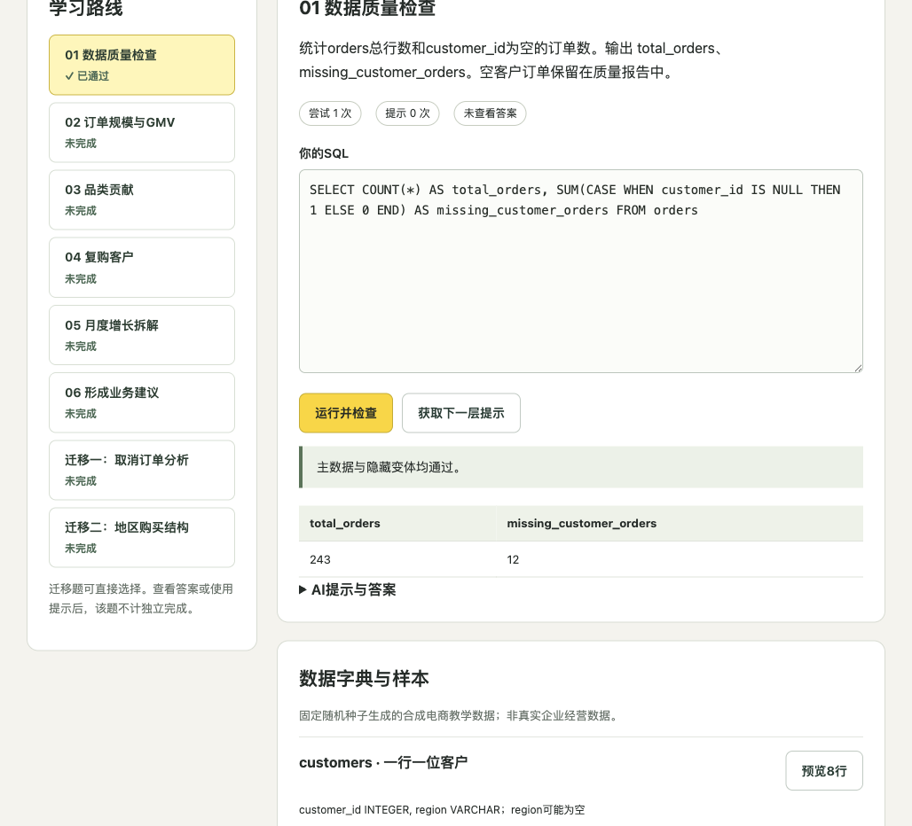

# 数据分析项目式学习教练

围绕电商经营分析，让学习者亲手编写SQL、检查结果、解释业务，并用新任务验证知识迁移。程序负责查询验收，AI辅助解释障碍与评审业务结论。

**当前状态：本地开发版。** SQL练习、固定提示与学习记录可直接使用；AI解释及结论评审尚未完成真实API联调。没有真人学习效果或留存结论。



## 学习路径

```text
业务任务 → 查看数据 → 编写SQL → 检查结果 → 分层提示 → 修正 → 迁移练习
```

| 任务 | 训练内容 |
|---|---|
| 数据质量检查 | 总行数、空值与分析范围 |
| 订单规模与GMV | 订单/明细粒度与重复计数 |
| 品类贡献 | 多表关联、聚合和排序 |
| 复购分析 | 客户分母与重复购买 |
| 月度增长拆解 | 订单数、GMV与客单价 |
| 业务建议 | 数据依据、替代解释、行动与验证 |
| 两个迁移任务 | 取消订单分析、地区购买结构 |

共6个主任务与2个迁移任务，其中7个是SQL任务；业务建议保留人工复核入口。

提示分为概念提醒、解题步骤、局部SQL三层。完整答案需主动查看；使用提示或查看答案后的通过不计为独立完成。

## 本地运行

要求Python 3.11、uv、Node.js 22/npm。SQL进程使用Unix资源限制，支持macOS/Linux；Windows建议使用WSL。

```bash
git clone https://github.com/Kenny030501/sql-project-learning-coach.git
cd sql-project-learning-coach
uv sync --frozen
npm ci --prefix frontend
npm run build --prefix frontend
uv run uvicorn backend.app:app --host 127.0.0.1 --port 8772
```

打开 http://127.0.0.1:8772 。macOS可双击`启动.command`。

无需API即可运行SQL、获取固定提示、查看参考答案及导出记录。启用AI时，将`.env.example`复制为`.env`，在本地填写DeepSeek或智谱官方密钥；运行`uv run python check_models.py`核验账号模型，设置`TEXT_PROVIDER`、`TEXT_MODEL`，核对价格后将`PAID_CALLS_ENABLED`设为true并重启。

## 教学数据与检查规则

4张表：customers、orders、order_items、products。主数据由固定种子生成，包含80位客户、20种商品、243笔订单及对应明细，保留空客户、空地区及不同订单状态。

全部为**合成教学数据**。教学币不代表真实平台收入或利润。

主数据之外另用2组隐藏数据检查，避免常数答案碰巧通过。允许等价SQL写法，按结果检查列名、行数、重复行、空值、必要排序及1e-6数值容差。源码包含标准答案，本项目不作为防作弊考试平台。

查询在独立进程中运行，限制5秒墙钟、3秒CPU、96MB DuckDB内存及500行返回。SQLGlot限制只读查询、教学表和函数；禁用外部访问、自动扩展及磁盘溢写。适用于受控本地练习，不替代互联网不可信代码的完整隔离。

## 技术实现

React/TypeScript、FastAPI、DuckDB、SQLGlot、SQLite，支持可切换的官方文本模型适配。

| 位置 | 用途 |
|---|---|
| frontend/src | 编辑器、结果表、进度与提示 |
| backend/curriculum.py | 任务、分层提示、参考解 |
| backend/data.py | 合成教学数据 |
| backend/sql_engine.py | 查询校验、结果比较、隐藏数据 |
| backend/sql_worker.py | 独立进程执行 |
| backend/providers.py | 模型适配与用量 |
| tests | SQL与应用流程测试 |

## 指标、费用与隐私

- 首次正确：第一次提交通过全部SQL检查。
- 独立完成：通过且未使用提示、未查看答案；查看答案撤销独立标记。
- 提示次数：固定提示或成功返回的AI提示请求。
- 修正次数：首次通过前的额外SQL提交。
- 耗时：首次开始至首次通过的墙钟时间，包含中断。
- 迁移表现：两道迁移题分别报告，不混同主任务。

记录保存在本机`.local/`，可导出和删除，不入库。必要SQL与结果只在用户同意后发送给模型。会话数不等于人数，任务通过也不证明长期掌握。

与面试仓库放在相同父目录时，共用`.ai-coach-state/budget.sqlite`，总预算5美元；否则须设置同一`COACH_BUDGET_DB`。已有账本继续指定原路径。
输入10、输出30美元/百万tokens是保守预留配置，不是官方报价，启用前须核对价格；未知计费失败保留预留，不自动充值。发布前未进行真实付费调用。

## 验证与当前边界

发布前**40项自动测试通过**。SQL核心包含7道参考查询、7道等价CTE写法、10类非法查询；另外检查隐藏数据、重复计数、空值、容差、排序、超时和学习流程。

```bash
uv run pytest -q
uv run ruff check backend tests check_models.py
npm run build --prefix frontend
```

前端构建、代码检查、桌面及390px窄屏检查通过；浏览器中实际完成质量检查查询与进度更新。测试依赖存在一项Starlette/httpx弃用提示，本次测试通过。

真实AI联调、真人试用、学习效果及长期使用表现尚待验证，不预设提升百分比。本项目使用AI辅助开发，技术测试与用户研究分别记录。

- [试用与指标](试用与指标.md)
- [验收记录](验收记录.md)
- [窄屏预览](docs/images/mobile.png)
- [配套面试陪练](https://github.com/Kenny030501/ai-project-interview-coach)
